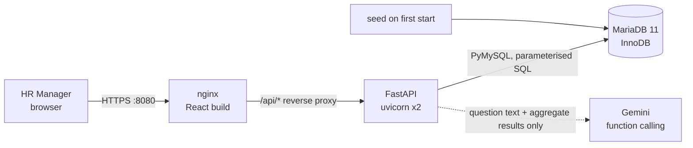
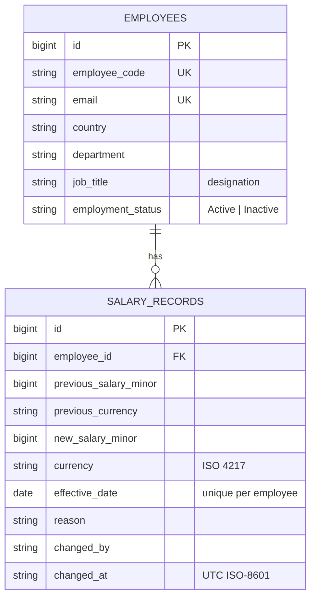

# Architecture and trade-offs

## Runtime view



Docker Compose starts the three containers in order using health checks: `mariadb` (healthy) → `api` (seeds if the database is empty, then serves) → `web`. The browser only ever talks to nginx, so the UI and API share one origin and the browser needs no CORS.

## Backend layering

```
api/routes.py          HTTP only: query params, status codes, map domain errors → 4xx/5xx
services/salaries.py   salary lifecycle rules (append-only, effective dating, atomic write)
services/insights.py   validated read-only insights + the Gemini question flow
repositories/*.py      all SQL (parameterised); returns plain dicts with JSON-safe numbers
db.py                  connection/transaction context manager, schema creation
schemas.py             Pydantic request/response contracts (mirrored in src/api/types.ts)
seed.py                pure generate() + idempotent seed()
```

Each layer depends only on the layer below it. Services take no FastAPI types, so they can be unit-tested with fakes.

## Data model



The **current salary** is the latest record whose `effective_date` is on or before today (UTC). It is computed in SQL, so a scheduled raise becomes current on its date with no background job.

## Frontend

- **Ant Design 6** components with one theme file (`src/theme.ts`), in strict **TypeScript**.
- **TanStack Query** holds all server state: caching, `keepPreviousData` so tables don't flicker while paging, and query invalidation after a salary write so the directory, drawer and reports refresh together.
- **The URL holds the view state**: filters, sort, page and the open employee. Views can be shared, and the back button works.
- `src/api/types.ts` mirrors `backend/schemas.py`, and a single `request()` turns FastAPI error bodies into readable messages.
- Money stays in **integer minor units** end to end. The UI parses typed amounts as strings (`"1250.50"` → `125050`), never through floats.

## Decisions and trade-offs

| Decision | Why | Trade-off accepted |
|---|---|---|
| **Append-only, effective-dated salary records** | Full audit trail. Future raises can be scheduled. Nothing is overwritten. | No back-dating through the API: corrections are new records dated today or later. |
| **No currency conversion**; every salary statistic is grouped by currency | No FX source or valuation policy was specified, and mixing currencies gives wrong answers. | No single org-wide pay figure. The UI shows one currency at a time and says so. |
| **Integer minor units** for money | No floating-point drift in storage or arithmetic. | Values are formatted at the edge (`formatMoney`). |
| **Gemini function calling over three allowlisted tools**, not text-to-SQL | Every number comes from tested code. Arguments are validated by Pydantic, and filter values are checked against real data. Gemini only sees aggregates. | Only questions those tools can answer are supported. Others get a clear "unsupported" error. |
| **Reports reuse the Gemini tools' `InsightService`** (`/api/insights/*`) | One tested code path. The dashboard answers the same questions without AI. | The AI feature stays optional. |
| **Percentiles computed in Python** over a narrow projection (salary and currency only) | One implementation that is exact and unit-tested. 10k rows take under 50 ms. | Revisit around 500k+ rows: SQL window functions or a nightly summary table (see `performance.md`). |
| **Salary sorting only within one country** | Comparing ₹ with $ by raw amount is misleading. | One extra click (choose a country) before sorting by pay. |
| **Single API + single database** | 10,000 records don't justify more services. | Scale vertically. |
| **Integration tests on real MariaDB; unit tests with fakes** | SQL behaviour is tested against the real engine, while rules and the AI flow stay fast and deterministic. | Integration tests need `docker compose up -d mariadb`; they skip with a message otherwise. |
| **Seed pay model** (designation × country market × lognormal noise) | Reports need realistic structure to be meaningful. | Seed-only conversion rates are used to produce plausible local numbers. The app never converts. |
| **nginx serves the UI and proxies the API** | Same origin, immutable caching of hashed assets, SPA fallback, security headers. | One more container. |

## Out of scope (see requirements §4)

Authentication and RBAC (in production, put this behind corporate SSO), payroll and tax, approvals, imports, FX conversion, and employee self-service.

## AI-assisted workflow

See [ai-usage.md](ai-usage.md) for which tools were used for what, the prompts, and what was verified by hand.
