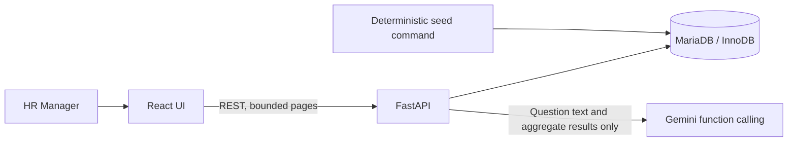
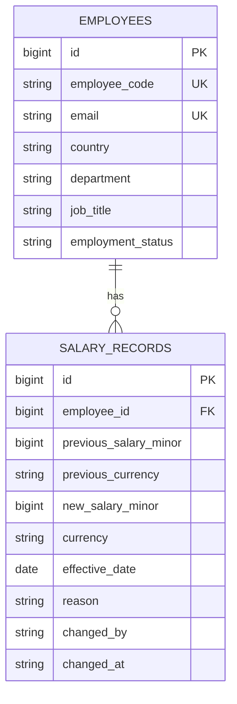

# Architecture and trade-offs

## Request path

## Data model

## Decisions

- **Layer boundaries:** FastAPI routes parse HTTP input and map domain errors; Pydantic schemas validate payloads; services enforce salary lifecycle rules; repositories own SQL; the database module owns connections and schema creation. Local settings load from `.env` using `.env.example` as a template.

- **MariaDB + InnoDB:** transactions and foreign keys protect salary-record inserts and preserve the employee relationship.
- **Append-only effective-dated salary records:** each change creates a new record with previous and new values. Future-effective records remain scheduled; reads select the latest record effective on the current UTC date. No background scheduler is needed for a date-based transition.
- **Integer minor units:** amounts avoid floating-point drift. Every salary record stores an ISO currency code; aggregates remain grouped by currency because no exchange-rate source or valuation policy was specified.
- **Server-side directory and reports:** search, filters, sorting, pagination, employee distributions, and salary summaries run in MariaDB. The API caps pages at 100 rows and the default is 25.
- **Natural-language questions:** when `GEMINI_API_KEY` is configured, Gemini function calling selects one of three allowlisted read-only insights. Pydantic validates its arguments and the backend executes the same tested aggregate services used for reporting. Only the question text and computed aggregate result are sent to Gemini; it receives no database access, SQL, or employee-level records. The response includes applied filters and supporting aggregates. Without a key, the UI disables this optional feature.
- **Model boundary:** free-text answers are phrased by Gemini from verified aggregate results. The UI displays those results for HR review; salary values remain grouped by currency. Text-to-SQL and direct model access to employee records are deliberately excluded.
- **Small application boundary:** one API and one relational database are sufficient for 10,000 records. Service decomposition would add operational cost without a stated need.
- **Explicit demo boundary:** authentication, approvals, payroll, imports, and currency conversion are omitted. The employee statuses are `Active` and `Inactive`. Synthetic data only until identity, authorization, secrets, privacy, backups, and hosting requirements are agreed.

## AI-assisted workflow

Codex was used to formalize the requirements, implement the MariaDB API/UI and tests in phases, and review edge cases such as mixed-currency statistics, future-dated salary records, server-side page limits, validation, and history preservation. The requirements and design decisions are reviewable artifacts. Run the documented tests in an environment with Python, npm dependencies, and MariaDB before treating the implementation as verified.
